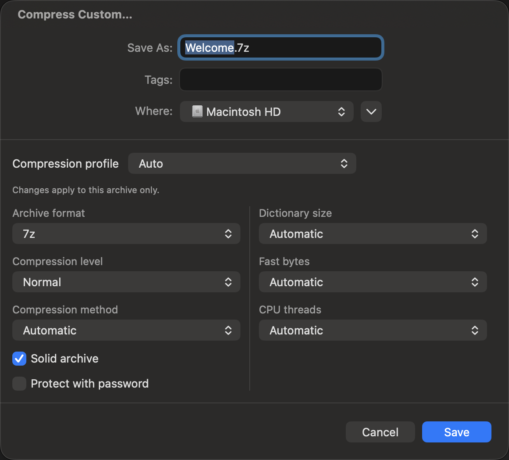
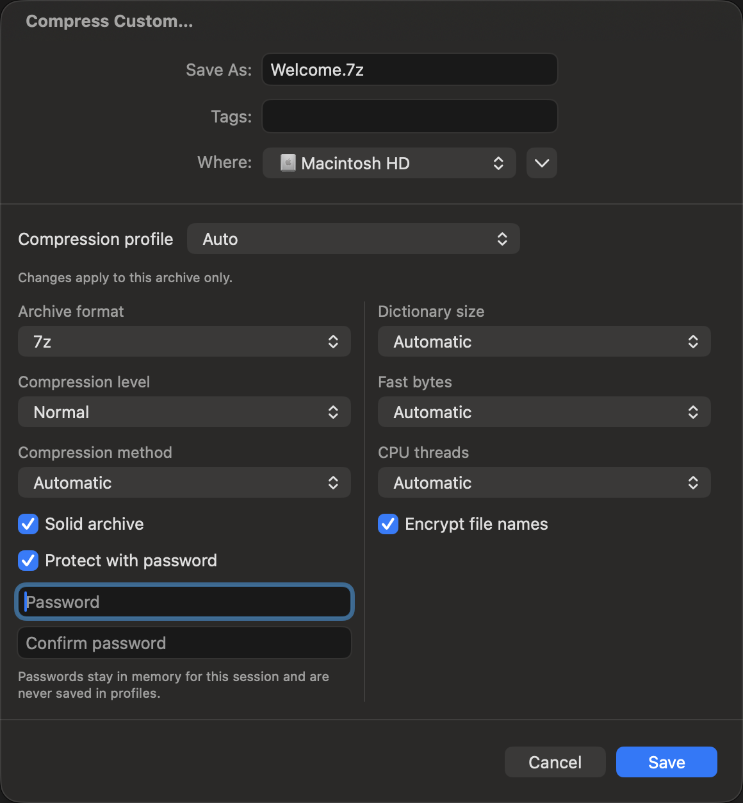
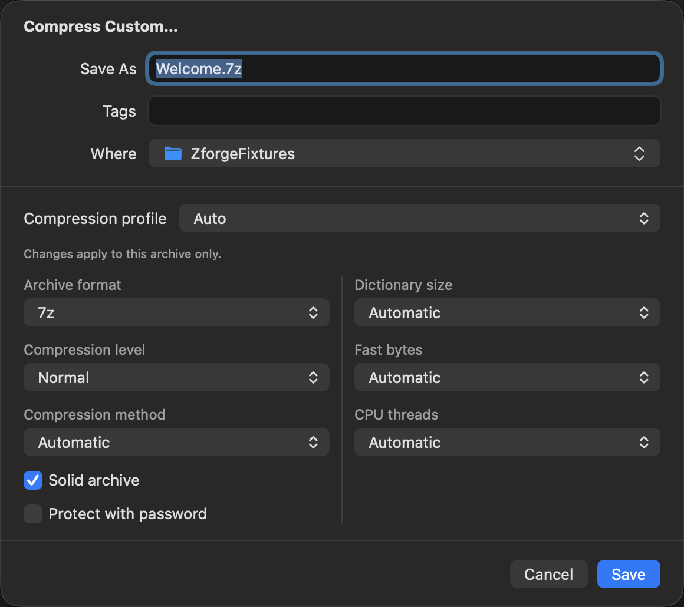

# Alternatives to the “Compress Custom...” panel

Visual studies presented before implementation. The alternative **A was chosen**; the implementation must keep the native header and footer of `NSSavePanel`, remove the field profile name and leave the creation/editing of profiles exclusively in Settings. The user refined A to put `Protect with password` to the left, just below `Solid archive`. When the protection is activated, the password fields are below this check and the height of the panel grows; `Encrypt file names` remains in the right column. The options chosen in the panel are only valid for the current archive.

| Alternativa | Organisation | Compromisso |
| --- | --- | --- |
| A — grade compacta | All applicable options visible in two columns | Quick comparison; It needs more horizontal width. |
| B — Progressive reveal | Common options visible; advanced parameters in `DisclosureGroup` | Menor altura inicial; requires opening the section to adjust advanced parameters. |
| C — Sections | `Picker` segmented for General, Advanced and Security | Steady height; distributes options over three screens. |

## A — grade compacta

## B — Advanced options collected

## C — General, Advanced and Security Sections

Conceptual images generated with the current capture as a reference. Text, dimensions and controls must be checked in the implementation SwiftUI/AppKit before final validation.

## Appraisal refinement

After the implementation of A, a new capture revealed inconsistent misalignments and widths in the selectors, as well as poorly used space in the area of name and destination. The user asked for alternatives **in images before any code change**. The studies below places `Save As` in the entire width and tests arrangements of `Tags` and `Where` in the next line. In all, the options selectors have the same width within the composition, `Protect with password` continues to the left below `Solid archive`, the password fields appear below check and `Encrypt file names` remains to the right.

| Estudo | Main area | Options |
| --- | --- | --- |
| [A — Inline grid](refinement-a-aligned-grid.png) | `Tags` and `Where` divide the line equally. | Side labels and selectors aligned in two columns. |
| [B — stacked fields](refinement-b-stacked-controls.png) | `Tags` compacta; `Where` occupies the remaining space. | Labels above wide selectors, in Archive and Performance groups. |
| [C — three columns](refinement-c-three-column-grid.png) | `Where` wide to the left; `Tags` on the right. | Six selectors in uniform three-column grid. |

The [A status with password enabled](refinement-a-password-expanded.png) illustrates the vertical growth of the modal and the position of the fields. The images are **visual proposals, not implemented behavior**. The feasibility of restructuring the native area of `NSSavePanel`, narrow window adaptation and the result in light theme, increased contrast and location still depend on the choice and subsequent validation.

### Direction after consultation of Apple guidelines

The user chose **`Tags` and `Where` with equal widths, as in A**, and prefers **labels above the selectors, as in B**, conditioning the latter point to compliance with Apple orientation. The official consultation found no prohibition for superior labels: [Layout](../../SwiftUI/contexts/hig-layout.md) emphasizes alignment, grouping and adaptation; [Pop-up buttons](../../SwiftUI/contexts/hig-pop-up-buttons.md) recommends an introductory label to make the choice predictable; [Text fields](../../SwiftUI/contexts/hig-text-fields.md) calls for clear association, spacing and consistent widths. The [`Form` in macOS](../../SwiftUI/contexts/swiftui-form.md) exemplifies the most common native layout in stack aligned with side labels; B is therefore an acceptable custom composition, not the automatic style of `Form`.

**Limit of implementation:** Zforge uses `NSSavePanel` with `accessoryView`. The [documented API `accessoryView`](../../SwiftUI/contexts/appkit-nssavepanel-accessoryview.md) allows composing the option area above the buttons and adjusting its height, but does not document repositioning the internal fields `Save As`, `Tags` and `Where`. To match exactly the widths of `Tags` and `Where` as in study A would require evaluating a sheet suitable for name/destination, with system folder selector, or accepting the arrangement native. Do not interpret the main area images as a layout already available in `NSSavePanel`. No change of UI was made in this investigation.

## Implementing refinement of the accessory

The user postponed the redesign of the native fields to first evaluate the other changes. The accessory now has 580 pt, labels above the selectors and native controls of uniform width. Height follows the activation of the password, keeping the fields below `Protect with password` and `Encrypt file names` on the right. Captures of a UI test run on the Debug build:

At that stage, `Save As`, `Tags` and `Where` remained in the `NSSavePanel` layout; The decision on these camps was still open.

## Subsequent top refinement

The above catches document the previous step. The user chose to keep `Save As`, `Tags` and `Where` in separate lines, expanding their controls, and extending the profile selector to the right edge of the grid. Since `NSSavePanel` does not expose a public API for this arrangement, the modal now uses a 580 pt SwiftUI sheet for the name, tags, and options; `Where` opens a `NSOpenPanel` native to choose the folder. The leaf height follows the password fields. The file name is validated before Save, and comma-separated tags are applied to the file after archive is created. The folder choice, actual creation, and tag application still need integrated verification.

Captures of the UI test approved in the Debug build, after standardizing header, top, options and footer with side margin of 20 pt:

