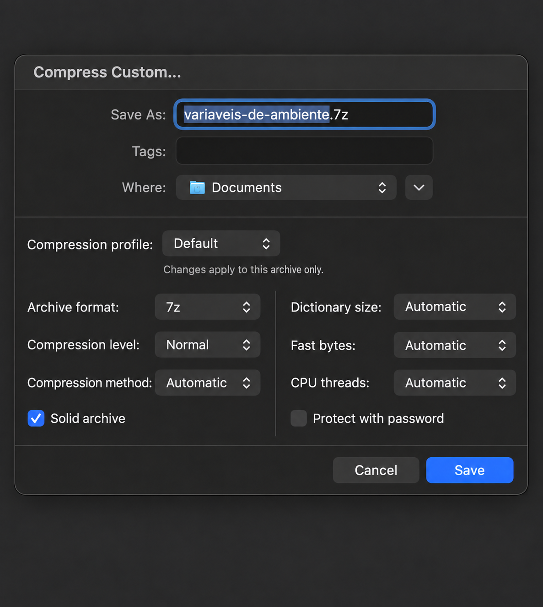
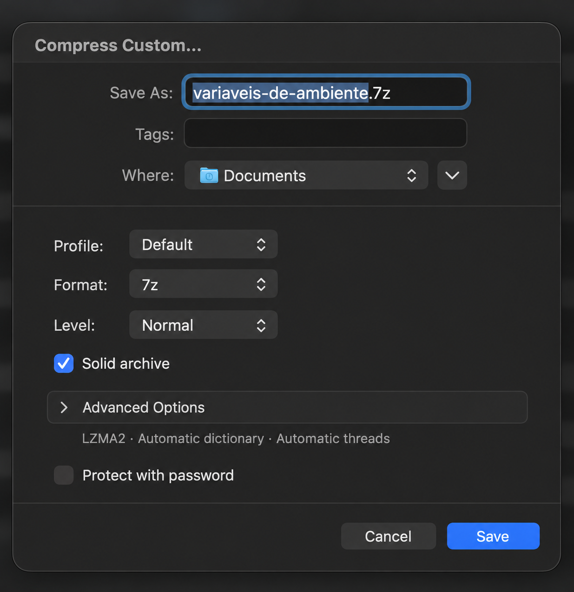
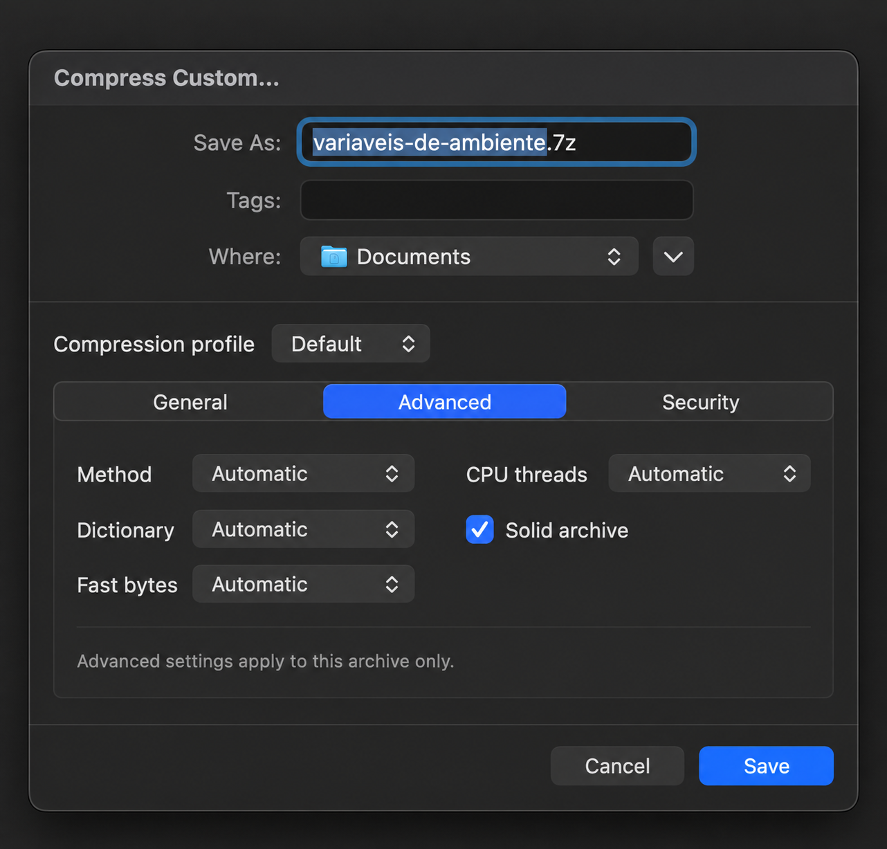
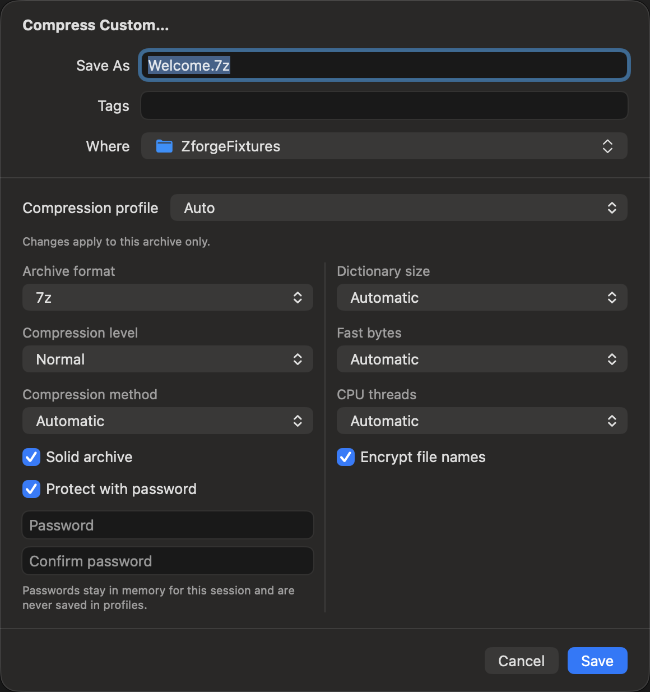

# Alternativas para o painel “Compress Custom…”

Estudos visuais apresentados antes da implementação. A alternativa **A foi escolhida**; a implementação deve manter o cabeçalho e o rodapé nativos do `NSSavePanel`, retirar o campo de nome de perfil e deixar a criação/edição de perfis exclusivamente em Settings. O usuário refinou A para colocar `Protect with password` à esquerda, logo abaixo de `Solid archive`. Quando a proteção é ativada, os campos de senha ficam abaixo desse check e a altura do painel cresce; `Encrypt file names` permanece na coluna direita. As opções escolhidas no painel valem apenas para o archive atual.

| Alternativa | Organização | Compromisso |
| --- | --- | --- |
| A — grade compacta | Todas as opções aplicáveis visíveis em duas colunas | Comparação rápida; precisa de mais largura horizontal. |
| B — revelação progressiva | Opções comuns visíveis; parâmetros avançados em `DisclosureGroup` | Menor altura inicial; exige abrir a seção para ajustar parâmetros avançados. |
| C — seções | `Picker` segmentado para Geral, Avançado e Segurança | Altura estável; distribui opções por três telas. |

## A — grade compacta

## B — opções avançadas recolhidas

## C — seções Geral, Avançado e Segurança

Imagens conceituais geradas com a captura atual como referência. Texto, dimensões e controles devem ser conferidos na implementação SwiftUI/AppKit antes da validação final.

## Refinamento em avaliação

Após a implementação de A, uma nova captura revelou desalinhamentos e larguras inconsistentes nos seletores, além de espaço mal aproveitado na área de nome e destino. O usuário pediu alternativas **em imagens antes de qualquer alteração de código**. Os estudos abaixo colocam `Save As` em toda a largura e testam arranjos de `Tags` e `Where` na linha seguinte. Em todos, os seletores de opções têm a mesma largura dentro da composição, `Protect with password` continua à esquerda abaixo de `Solid archive`, os campos de senha surgem abaixo do check e `Encrypt file names` permanece à direita.

| Estudo | Área principal | Opções |
| --- | --- | --- |
| [A — grade alinhada](refinement-a-aligned-grid.png) | `Tags` e `Where` dividem a linha igualmente. | Rótulos laterais e seletores alinhados em duas colunas. |
| [B — campos empilhados](refinement-b-stacked-controls.png) | `Tags` compacta; `Where` ocupa o espaço restante. | Rótulos acima de seletores largos, em grupos Archive e Performance. |
| [C — três colunas](refinement-c-three-column-grid.png) | `Where` ampla à esquerda; `Tags` à direita. | Seis seletores em grade uniforme de três colunas. |

O [estado A com senha ativada](refinement-a-password-expanded.png) ilustra o crescimento vertical do modal e a posição dos campos. As imagens são **propostas visuais, não comportamento implementado**. A viabilidade de reestruturar a área nativa do `NSSavePanel`, a adaptação em janela estreita e o resultado em tema claro, contraste aumentado e localização ainda dependem da escolha e de validação posterior.

### Direção após consulta às diretrizes Apple

O usuário escolheu **`Tags` e `Where` com larguras iguais, como em A**, e prefere **rótulos acima dos seletores, como em B**, condicionando este último ponto à conformidade com a orientação Apple. A consulta oficial não encontrou proibição para rótulos superiores: [Layout](../../SwiftUI/contexts/hig-layout.md) enfatiza alinhamento, agrupamento e adaptação; [Pop-up buttons](../../SwiftUI/contexts/hig-pop-up-buttons.md) recomenda um rótulo introdutório para deixar a escolha previsível; [Text fields](../../SwiftUI/contexts/hig-text-fields.md) pede associação clara, espaçamento e larguras consistentes. O [`Form` no macOS](../../SwiftUI/contexts/swiftui-form.md) exemplifica a disposição nativa mais comum em pilha alinhada com rótulos laterais; B é, portanto, uma composição customizada aceitável, não o estilo automático de `Form`.

**Limite de implementação:** o Zforge usa `NSSavePanel` com `accessoryView`. A [API documentada de `accessoryView`](../../SwiftUI/contexts/appkit-nssavepanel-accessoryview.md) permite compor a área de opções acima dos botões e ajustar sua altura, mas não documenta reposicionar os campos internos `Save As`, `Tags` e `Where`. Igualar exatamente as larguras de `Tags` e `Where` como no estudo A requereria avaliar uma folha própria para nome/destino, com seletor de pasta do sistema, ou aceitar o arranjo nativo. Não interpretar as imagens da área principal como um layout já disponível no `NSSavePanel`. Nenhuma mudança de UI foi feita nesta investigação.

## Refinamento implementado do acessório

O usuário adiou o redesenho dos campos nativos para avaliar primeiro as demais alterações. O acessório agora tem 580 pt, rótulos acima dos seletores e controles nativos de largura uniforme. A altura acompanha a ativação da senha, mantendo os campos abaixo de `Protect with password` e `Encrypt file names` à direita. Capturas de um teste de UI executado na build Debug:

Naquela etapa, `Save As`, `Tags` e `Where` permaneciam no layout do `NSSavePanel`; a decisão sobre esses campos ainda estava aberta.

## Refinamento posterior do topo

As capturas acima documentam a etapa anterior. O usuário escolheu manter `Save As`, `Tags` e `Where` em linhas separadas, ampliando seus controles, e estender o seletor de perfil até a borda direita da grade. Como o `NSSavePanel` não expõe uma API pública para esse arranjo, o modal agora usa uma folha SwiftUI de 580 pt para nome, tags e opções; `Where` abre um `NSOpenPanel` nativo para escolher a pasta. A altura da folha acompanha os campos de senha. O nome do arquivo é validado antes de Save, e as tags separadas por vírgula são aplicadas ao arquivo após a criação do archive. A escolha de pasta, a criação real e a aplicação de tags ainda precisam de verificação integrada.

Capturas do teste de UI aprovado na build Debug, em inglês, após uniformizar cabeçalho, topo, opções e rodapé com margem lateral de 20 pt:

