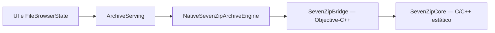

# ZF-21 — plano de integração estática do 7-Zip

Data: **2026-10-02**. Estado: **backend e build implementados em 2026-10-03; validação externa e distribuição pendentes**. A linkagem estática foi escolhida pelo usuário. O usuário refinou o escopo para arm64 exclusivamente e macOS mínimo 26.0; x86_64 fica fora do suporte. Este plano adota execução no processo do app para a primeira implementação. O estado vigente continua em [CURRENT-STATE.md](CURRENT-STATE.md), §6; o rastreamento está em [TASKS.md](../../TASKS.md#zf-21--motor-nativo-do-7-zip-compilado-com-o-zforge) e [OR-10](OPEN-REQUIREMENTS.md).

## Resultado esperado

A build do Zforge compila o código-fonte oficial do 7-Zip para arm64 e incorpora o motor ao executável principal. O produto final realiza as operações por chamadas nativas, sem `7zz`, parsing de saída textual ou biblioteca dinâmica do motor. O código incorporado fica coberto pela assinatura do executável Zforge. Serviço XPC poderá ser avaliado em uma mudança futura; ele não faz parte desta implementação.

Todos esses componentes executam no processo do Zforge. Chamadas síncronas do motor ficam em workers fora da thread principal. O isolamento lógico do motor permanece em módulos e contratos; o processo do app também assume o impacto de falhas nativas fatais.

## Organização proposta

| Local | Responsabilidade |
| --- | --- |
| `Vendor/7zip/` | Snapshot das fontes oficiais e licenças, sem arquivos locais do checkout irmão. |
| `Vendor/7zip-provenance.json` | Versão, revisão completa, origem, checksum do snapshot e configuração de build. |
| `Vendor/7zip-patches/` | Patches mínimos separados, com motivo e instrução de aplicação. |
| `BuildSupport/SevenZip/` | Manifesto de fontes, configuração e scripts incrementais de compilação. |
| Target `SevenZipCore` | Biblioteca estática C/C++, com formatos e codecs multiformato. |
| `Zforge/Native/SevenZipBridge.h` e `.mm` | Interface Objective-C compatível com Swift; ownership, conversões e callbacks ficam no adaptador. |
| `Zforge/Services/NativeSevenZipArchiveEngine.swift` | Implementação de `ArchiveServing`, integração de sessões/políticas, execução e cancelamento. |
| `ZforgeTests/Fixtures/Archives/` | Fixtures pequenas versionadas e geradores reproduzíveis para cenários maiores. |

Os nomes acima foram propostos no plano. A implementação usa a fase `Build SevenZipCore`, `ArchiveEntry.swift`, `NativeSevenZipBackend.swift` e `NativeSevenZipArchiveEngine` em `ArchiveEngine.swift`. `libSevenZipCore.a` é um produto intermediário da build e não é copiado para o `.app`. Objetos, dependências e arquivos temporários do motor ficam em `$(TARGET_TEMP_DIR)/SevenZip`; a fase declara a biblioteca final como saída e Debug/Release vinculam esse mesmo caminho. O sandbox de scripts do Xcode permanece habilitado. Headers públicos do adaptador não expõem tipos C++, ponteiros de interfaces do 7-Zip ou sintaxe CLI à UI.

## 1. Caracterizar o backend atual e preparar a migração

- Inventariar todas as operações de `ArchiveServing`, os campos de `BrowserItem`, o ciclo das sessões e os contratos de §6 de `CURRENT-STATE.md`.
- Registrar os testes existentes que realmente executam `SevenZipArchiveEngine`, distinguindo-os de fixtures de UI e testes do parser textual.
- Extrair apenas as partes necessárias para compartilhar sessões, políticas de navegação/materialização e conflitos entre backends. Desacoplar a estrutura `Entry` de `SevenZipListingParser` e separar normalização de caminhos da leitura da CLI.
- Separar `CompressionOptions` e perfis persistidos da tradução `commandArguments`: o backend CLI conserva seu tradutor; o nativo ganha um tradutor de propriedades.
- Manter o backend CLI como referência explícita de testes durante a migração. Nenhum fallback automático em produção deve esconder uma operação ainda não portada ou repetir uma operação de escrita após falha.

**Saída verificável:** matriz `operação → contrato → teste → lacuna`, com suíte atual executada e contagem registrada. Refatorações preliminares precisam passar nos testes existentes antes de receber o motor nativo.

## 2. Incorporar as fontes e construir a biblioteca estática

- Usar inicialmente a versão local **26.02**, revisão `f9d78aff31a5f2521ae7ddbdc97c4a8855808959`, para comparar com a versão do motor em uso. Atualização de versão será uma decisão rastreada, evitando misturar mudança de backend com mudança de comportamento upstream.
- Vendorizar fontes correspondentes e licenças; a build deve funcionar a partir de um clone do Zforge sem `../7zip`, sem instalação externa e sem download durante a build.
- Derivar o manifesto multiformato de `CPP/7zip/Bundles/Format7zF/Arc_gcc.mak`, incluindo codecs, handlers e dependências C/C++ necessários. A receita oficial é compartilhada: a adaptação para arquivo `.a` faz parte desta etapa.
- Excluir entrypoints de console e descoberta de plugins externos. Auditar configurações, registro de codecs, inicializadores e alterações de estado global antes de incorporar fontes ao processo do app.
- Gerar produtos separados por arquitetura/configuração em diretórios de build; alinhar deployment target e SDK com o app. Preservar multithreading e usar implementações C/assembly compatíveis com cada arquitetura.
- Integrar dependências, inputs e outputs no Xcode para uma build incremental reproduzível, sem gerar objetos dentro das fontes do fornecedor.
- Garantir que o linker inclua os objetos que registram formatos/codecs por inicializadores. Avaliar `-force_load` restrito à biblioteca do motor ou uma estratégia explícita de retenção; não aplicar `-all_load` globalmente sem necessidade.

**Saída verificável:** biblioteca e executável mínimo ligados estaticamente em Debug e Release, com inventário de formatos/leitura/escrita esperado. Conferir o resultado com dead stripping habilitado. O único destino suportado é Apple Silicon (arm64), com macOS mínimo 26.0.

## 3. Implementar a fronteira Swift / Objective-C++ / 7-Zip

- Expor abertura/fechamento, propriedades, extração seletiva, teste, criação e atualização com resultados tipados, handles controlados e IDs por operação/entrada.
- Implementar streams de entrada/saída, callbacks de abertura/volumes, `IArchiveExtractCallback`, `IArchiveUpdateCallback`, `IProgress`, `ICryptoGetTextPassword` e `ICryptoGetTextPassword2`, conforme a operação.
- Conter exceções C++ no adaptador; gerenciar interfaces com RAII e balancear referências, buffers e strings. Não permitir exceções ou ponteiros sem ownership atravessando a fronteira Swift.
- Traduzir `HRESULT` e resultados por entrada para erros/avisos do domínio. Sucesso da chamada geral não comprova sucesso de todos os itens. Distinguir senha ausente, senha inválida e corrupção quando o handler fornece evidência; não inferir senha errada de qualquer erro criptografado.
- Manter senha somente em memória pelo tempo autorizado da sessão/operação, sem logs, perfis ou persistência; liberar cópias temporárias controladas pelo adaptador.
- Serializar uso de cada instância `IInArchive`, conforme a restrição do código oficial. Adotar worker por sessão/operação e token de cancelamento thread-safe, inclusive em callbacks de streams/progresso. Um actor Swift sozinho não transforma a chamada C++ em cancelável.
- Evitar bloqueios da thread principal e ciclos de espera entre callbacks nativos e resolutores assíncronos. Preferir resolver conflitos na camada Swift antes da escrita e entregar ao adaptador um plano de destinos.
- Limitar frequência de notificações de progresso sem bloquear os callbacks que verificam cancelamento; fechar uma sessão durante trabalho em andamento deve cancelar/aguardar com segurança antes de liberar seus handles.

**Saída verificável:** prova pequena de listagem, extração e teste de ZIP/7z reais, incluindo senha, cancelamento, falha por entrada e fechamento. Conferir ownership com ferramentas de diagnóstico de memória em casos dirigidos.

## 4. Portar leitura, navegação, extração e validação

- Implementar reconhecimento por assinatura/propriedades e abertura de volumes relacionados, não apenas por extensão. Fixtures devem cobrir ZIP/7z, RAR somente leitura, TAR, streams e amostras dos demais grupos reconhecidos.
- Converter propriedades diretamente para os modelos vigentes, sintetizar diretórios virtuais e preservar nomes Unicode, datas, tamanhos desconhecidos e a correspondência entre caminho visível e índice do motor. Caracterizar nomes duplicados e nomes com separadores/novas linhas antes de definir sua projeção.
- Implementar teste com `IInArchive::Extract` em modo de teste e agregar resultados por item. Validar seleção múltipla sequencial conforme o contrato vigente.
- Portar extração completa/seletiva e materialização para preview, abertura externa e aninhamento. Seleção em archive sólido pode exigir decodificar dados anteriores; não prometer custo proporcional apenas ao item selecionado.
- Aplicar validação de caminhos e contenção real no destino, incluindo links e componentes que poderiam redirecionar a escrita para fora da pasta autorizada. Reaproveitar decisões de conflito e limites de bytes efetivamente produzidos.
- Preservar limites de profundidade/tamanho, limpeza de sessão, materialização somente leitura, quarentena e proteção contra publicação de resultados obsoletos nas quatro visualizações.
- Inicialmente conservar staging/cache da sessão para manter os contratos atuais enquanto se valida o backend. Remover cópias da origem por motivo de I/O exige etapa própria, pois muda a relação entre sessão e alterações externas do archive.

**Saída verificável:** testes de leitura, extração, senha, aninhamento, limites, volumes e conflitos executados contra o backend nativo. Comparar conteúdo e metadados com a referência CLI quando aplicável.

## 5. Portar criação e atualização

- Mapear formato, método, nível, dicionário, bytes rápidos, sólido, threads e criptografia para `ISetProperties` e callbacks nativos. Validar as propriedades aceitas por cada handler; não transpor switches da CLI sem verificar seu significado na API.
- Implementar criação de 7z, ZIP, TAR, XZ, BZIP2, GZIP e WIM. Preservar a camada TAR quando streams recebem múltiplas entradas/pastas, nomes livres de saída, tags e os perfis já persistidos.
- Implementar `UpdateItems` para adicionar a ZIP/7z de volume único: combinar entradas existentes e novas, ler streams autorizados e escrever uma saída temporária. Atualização de archive não implica escrita no original em lugar.
- Preservar confirmação, rejeição de auto inclusão/volumes/aninhados, validação da saída, substituição do original apenas após êxito e refresh da sessão aberta.
- Cancelamento, senha errada, falta de espaço e falhas de entrada/saída devem preservar o archive original e limpar temporários de forma verificável. A autorização deve permanecer ativa durante toda a operação e a substituição.

**Saída verificável:** round trips de todos os formatos de saída; criptografia ZIP/7z; atualização com entradas antigas preservadas, inclusive em pasta interna; original preservado byte a byte nos cenários de falha e cancelamento.

## 6. Integrar e validar no app

- Selecionar o backend nativo na composição de produção depois de completar a paridade. Migrar os testes de integração para que executem esse backend, com fixtures versionadas; o binário CLI pode ser usado apenas como ferramenta de referência de desenvolvimento enquanto necessário.
- Remover do bundle a fase de cópia de `Vendor/7zz`, a descoberta de helper e overrides de ambiente do backend de produção. Remover runner/parser/tradutores CLI quando nenhum fluxo de produção depender deles; reaproveitar seus testes de segurança nos componentes independentes.
- Validar em build assinada o fluxo real de permissões, fontes/destinos em pastas diferentes, volumes relacionados e reinício com bookmarks. Acesso no mesmo processo exige autorização ativa; não concede acesso geral ao filesystem.
- Conferir Ícones, Lista, Colunas, Galeria, seleção múltipla, menus/toolbar/teclado, Finder, Recentes, preview, atualização por drop e diálogos de senha/conflito/cancelamento.
- Medir abertura/listagem, extração e compressão com arquivos grandes e muitos pequenos: tempo, memória máxima, espaço temporário, cancelamento e responsividade. Registrar hardware, build Release, opções, cache frio/quente e staging para interpretar a comparação; não exigir arquivos compactados byte a byte idênticos quando metadados diferirem.

**Saída verificável:** funcionalidades operam na build assinada com o motor nativo e contagem real de testes registrada. `otool -L`, inventário do bundle e mapa/símbolos de linkagem confirmam a ausência de dependência dinâmica do 7-Zip e a presença do motor no executável. Comparações de desempenho são evidência medida, não condição presumida da linkagem estática.

## 7. Preparar a distribuição e concluir os contratos

- Executar build Release arm64, validar assinatura/Hardened Runtime e preparar fonte correspondente, patches, licenças e instruções de recompilação/relinkagem. Conferir a reprodução em checkout limpo e que uma modificação do motor pode ser incorporada em uma build local.
- Verificar a distribuição do site com Developer ID, notarização e ticket quando houver identidade/acesso de lançamento autorizados. Executar em Apple Silicon; o deployment target mínimo do app e do motor é macOS 26.0.
- Preparar a variante Mac App Store conforme os requisitos existentes, incluindo Sandbox e revisão das condições LGPL/unRAR. Build local e notarização do site não comprovam aceitação na loja.
- Atualizar `CURRENT-STATE.md` após implementação, refletir a evidência real em `REGRESSION-COVERAGE.md`, concluir ZF-21 somente para o escopo validado e manter pendências de distribuição em OR-10. Registrar divergências concretas em `DIVERGENCES.md` se surgirem.

**Saída verificável:** o app entregue contém o motor estático e opera sem executável/biblioteca externa do 7-Zip. Gates dependentes de credenciais, revisão ou hardware indisponíveis ficam explicitamente pendentes; não se registra distribuição concluída apenas porque a build local passou.

## Marcos para revisão

1. **Build estática comprovada:** fontes reproduzíveis, handlers preservados em Release e ponte mínima funcionando.
2. **Leitura completa:** navegar, extrair, testar e materializar com senha, cancelamento e limites.
3. **Escrita completa:** criar todos os formatos suportados e atualizar ZIP/7z com preservação do original.
4. **Backend de produção:** integração real no app, regressões verificadas e retirada do `7zz` do bundle.
5. **Distribuição:** assinatura e materiais de licença/relinkagem verificados; canais externos somente com suas evidências específicas.

Cada marco deve resultar em uma alteração revisável de responsabilidade coerente. O primeiro trabalho de implementação é a etapa 1 seguida da prova estática da etapa 2; os riscos de linker/registro e da ponte são resolvidos antes de portar toda a superfície funcional.

## Evidência inicial do planejamento em 2026-10-02

- Inspeção do workspace em 2026-10-02: `ArchiveServing`, `SevenZipArchiveEngine`, `SevenZipProcessRunner`, `SevenZipListingParser`, `CompressionOptions`, `AccessGrantStore`, testes de archives e configuração de embedding do Xcode.
- Fontes oficiais locais 26.02: `Format7zF/Arc_gcc.mak`, `Common/RegisterArc.h`, `Common/RegisterCodec.h`, `Archive/IArchive.h` e `IPassword.h`. As macros de registro usam inicializadores; `IArchive.h` proíbe chamadas simultâneas na mesma instância de `IInArchive`.
- A etapa inicial produziu um plano e decisões documentais. Ela não executou build, benchmarks, testes de operação nativa, notarização ou validação da ponte.

## Execução em 2026-10-03

- Fontes oficiais vendorizadas sem patches; `.a` arm64 incorporada por `-force_load` restrito. MacOS mínimo 26.0; nenhuma dependência x86_64.
- Ponte tipada, workers, cancelamento, propriedades, resultados por item, streams de volumes, escrita/atualização e permissões/links implementados. UI conserva `ArchiveServing` e suas políticas.
- Referência CLI: 98 testes aprovados. Testes passaram contra o backend nativo; contagem final e artefatos estão em `REGRESSION-COVERAGE.md`.
- Runner/parser/tradutor CLI removidos; helper não é copiado ao app. `Vendor/7zz` permanece somente como referência de desenvolvimento para gerar/comparar fixtures, sem uso pelo produto.
- Recompilação e relinkagem de cópia modificada do motor comprovadas; instruções em `BuildSupport/SevenZip/README.md`.
- Testes de UI não conseguiram ativar o app (Running Background). Runtime macOS 26.0, acesso externo/bookmarks, matriz ampliada de leitura e canais de distribuição permanecem em OR-10. Não publicar nem marcar notarização/loja concluídas com base nessa build local.
