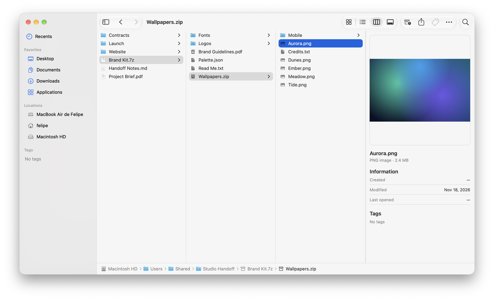

<p align="center">
  
</p>

<h1 align="center">Zforge</h1>

<p align="center">A native macOS file manager for archives, built on 7-Zip.</p>

<p align="center">
  <picture>
    <source media="(prefers-color-scheme: dark)" srcset="./.github/readme/hero-dark.png" />
    
  </picture>
</p>

Zforge aims to bring 7-Zip File Manager capabilities to Mac, with the twist of treating them like simple folders. You browse an archive the way you browse a folder: look inside, preview a file, drag a copy out, all without unpacking the archive first. An archive inside another archive is just one more level to open. All in a native SwiftUI application.

> [!NOTE]
> Zforge is in active development (version 0.0.1). There is no public build yet, so for now the only way to run it is to [build it from source](#build-from-source).

## What you get

- **Archive formats.** Open 7z, ZIP, RAR, TAR, ISO, CAB, WIM, ARJ, LZH, CPIO and XAR archives, gzip, bzip2, xz and Zstandard files, compressed tarballs and split archives.
- **Archives inside archives.** Open a ZIP stored in a 7z the same way you opened the 7z, at any depth.
- **File browsing.** Browse folders and archives in Icons, List, Columns or Gallery view, with tabs, sidebar favorites, Finder tags, Quick Look and search.
- **Archive editing.** Add, move and remove items in ZIP and 7z archives, including split `.001` sets, with drag and drop. Zforge asks you to confirm each change. Changes to an archive stored inside another one are saved back when you leave it.
- **Compression profiles.** Create 7z, ZIP, TAR, XZ, BZIP2, GZIP and WIM archives, and split ZIP and 7z archives into volumes. Save the format, level, method and other options you use most as a profile.
- **Finder integration.** Once the Finder extension is enabled, a Zforge submenu appears when you right-click files in Finder. From there you can open, extract or validate archives, compress files and folders, or add them to an existing archive.
- **Automation.** Use Shortcuts or an MCP client, such as an AI agent, to create ZIP and 7z archives, extract them or test their integrity.
- **21 languages.** Most translations started as machine drafts. If you spot an error, please open an issue.

Zforge can open and extract RAR archives, but it cannot create them.

## How it works

The 7-Zip engine is compiled from the official sources in [`Vendor/7zip`](./Vendor/7zip) and linked statically into the app. Zforge does not bundle or run the `7zz` command-line tool. It calls 7-Zip's archive interfaces through an Objective-C++ bridge and keeps that work off the main thread.

Two rules shape how archives are handled:

- **Reading happens in place.** Zforge reads archives on disk directly, without copying them first. It extracts only what it needs: the items you open, preview or drag out, and a working copy of an archive stored inside another one when you open it.
- **The original is replaced only by a valid result.** An update is written beside the archive and validated before it replaces the original. A split archive is replaced one volume at a time, and a failure puts the old volumes back.

The app runs in the App Sandbox, so it can reach only the files and folders you open or grant access to.

## Requirements

- A Mac with Apple Silicon
- macOS 26 or later

## Build from source

You need Xcode. The project is currently maintained with Xcode 27.2.

```bash
git clone https://github.com/zforge-app/zforge.git
cd zforge
open Zforge.xcodeproj
```

In Xcode, open Signing & Capabilities for the `Zforge` and `ZforgeFinderExtension` targets. Choose your own team, and replace the `io.libor` prefix of both bundle identifiers with one of your own, since those identifiers are registered to another team. Then run the `Zforge` scheme.

The first build also compiles 7-Zip, so it takes longer than later builds. Xcode fetches the two Swift packages on its own, and nothing else needs to be installed.

To run the unit tests:

```bash
xcodebuild test -project Zforge.xcodeproj -scheme Zforge -testPlan Unit
```

## Use it from an agent

Zforge's executable doubles as an [MCP](https://modelcontextprotocol.io) server. In Settings ▸ Automation, choose **Copy MCP Configuration** and paste the result into your MCP client. The configuration points to the copy of Zforge you are running, so copy it again if you move the app.

The first time an agent needs a folder, Zforge asks you to choose it. You can also allow folders in advance in the same pane. [Agent usage](./Documentation/Requirements/AGENT-USAGE.md) lists the tools and their limits.

## Documentation

The project keeps its requirements next to the code:

- [Current state](./Documentation/Requirements/CURRENT-STATE.md): what the app does today, feature by feature
- [Product requirements](./Documentation/Requirements/PRODUCT-REQUIREMENTS.md): the vision, the engine, licensing and distribution
- [UI and UX guide](./Documentation/Requirements/UI-UX-GUIDE.md): how the interface should look and behave

The [documentation index](./Documentation/AGENTS.md) lists everything else.

## Issues and contributions

Zforge does not accept code contributions, so only the project's maintainers can open pull requests.

Bug reports and feature requests are welcome in [Issues](https://github.com/zforge-app/zforge/issues). For a bug, include your macOS version, the archive format, and the steps that lead to the problem.

Zforge's own code is MIT licensed, so you are free to fork it and take it in your own direction.

## License

Zforge's own code is under the [MIT license](./LICENSE).

The 7-Zip sources in `Vendor/7zip` keep their own licenses: mostly the GNU LGPL, with some BSD-licensed parts and the unRAR restriction. See [`Vendor/7zip/DOC/License.txt`](./Vendor/7zip/DOC/License.txt), or Zforge ▸ Acknowledgments… in the app. Learn more about 7-Zip at [7-zip.org](https://www.7-zip.org/).
